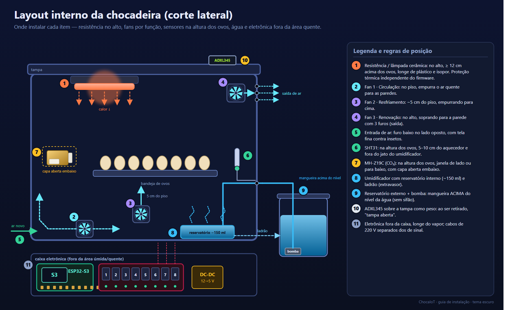
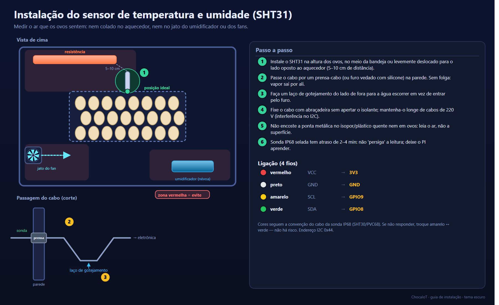
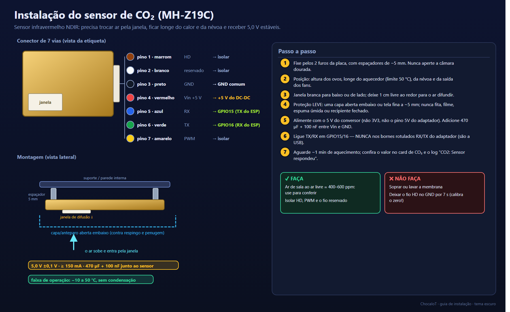
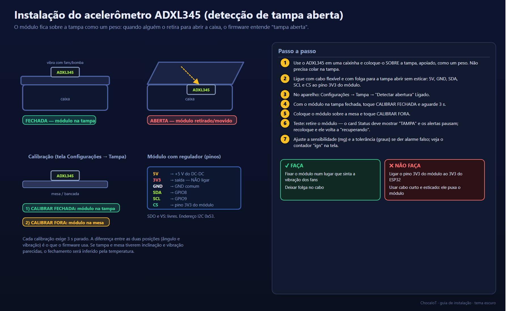
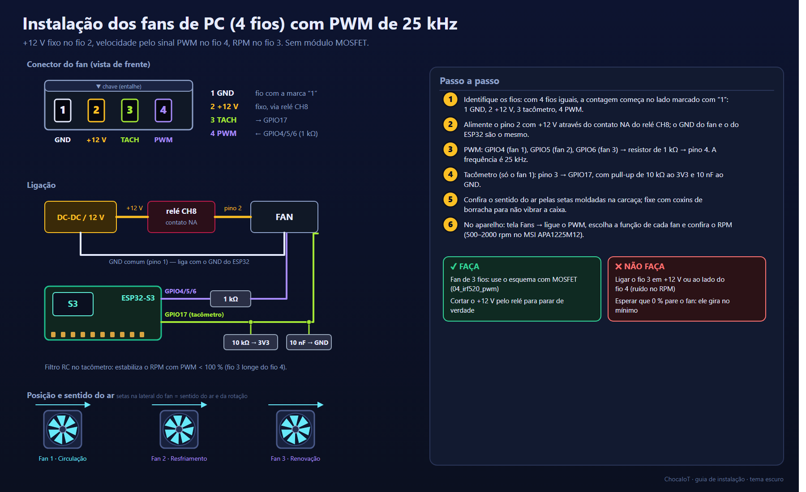
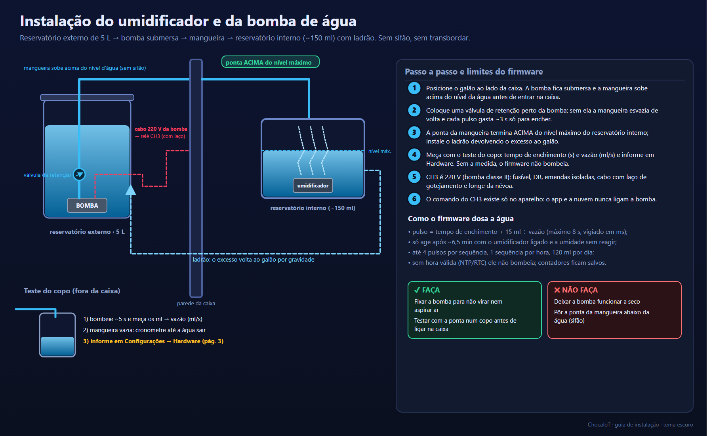
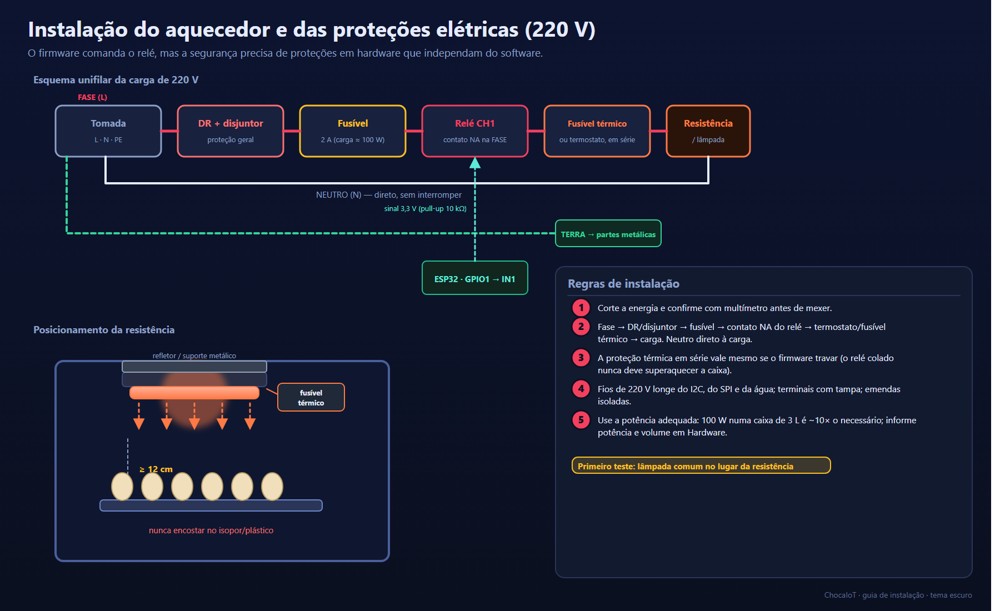
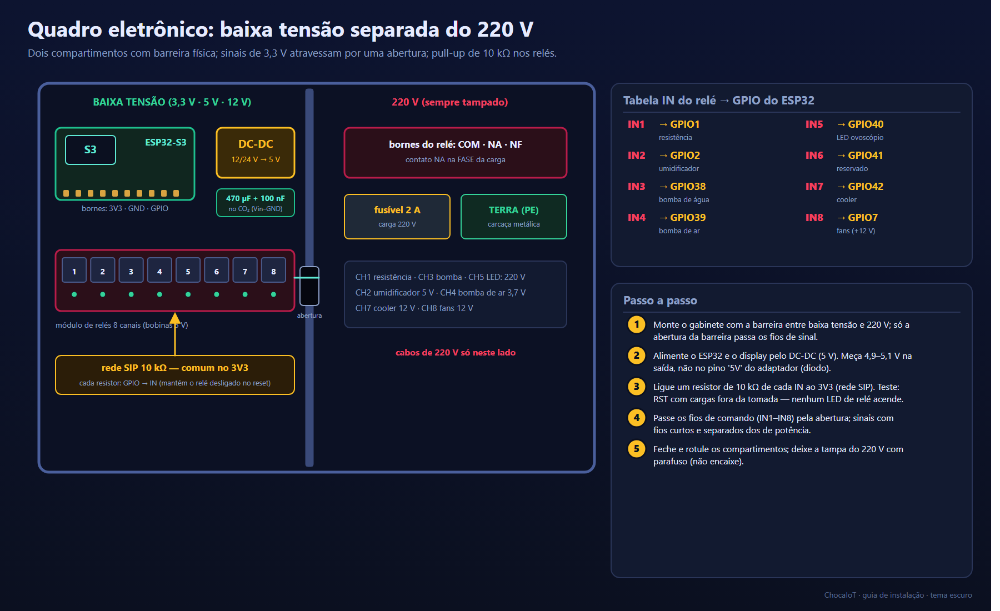

# 08 — Guia de instalação (passo a passo ilustrado)

Imagens em **tema escuro**, geradas por [`docs/instalacao/gerar_instalacao.py`](instalacao/gerar_instalacao.py) (SVG editável + PNG).
Cada item abaixo traz: a ilustração, o que fazer, o que evitar e como **conferir** que ficou certo.

> ⚠️ Cargas de **220 V**: desligue da tomada e meça com multímetro antes de tocar. Leia [`05-seguranca.md`](05-seguranca.md).

## Ordem recomendada de montagem

| # | Etapa | Por quê nesta ordem |
|---|---|---|
| 1 | Quadro eletrônico e proteções (item 8 e 7) | Base segura: nada liga sozinho |
| 2 | Aquecedor (item 7) | Maior risco; teste com lâmpada comum antes |
| 3 | Fans (item 5) | Circulação antes de aquecer |
| 4 | Sensores SHT31 e CO₂ (itens 2 e 3) | Precisam do ar já circulando |
| 5 | Umidificador e bomba (item 6) | Água por último, com tudo testado |
| 6 | ADXL345 na tampa (item 4) | Calibra com a caixa fechada |

---

## 1. Layout interno da caixa



**Regras de posição (resumo):**

| Item | Onde | Distância/observação |
|---|---|---|
| Resistência | alto da caixa | ≥ 12 cm dos ovos; sem tocar isopor/plástico |
| Fan 1 (circulação) | piso | empurra o ar quente para as paredes |
| Fan 2 (resfriamento) | ~5 cm do piso | sopra para cima |
| Fan 3 (renovação) | alto | sopra para a parede com 3 furos |
| Entrada de ar | furo baixo, lado oposto | com tela fina |
| SHT31 | altura dos ovos | 5–10 cm do aquecedor |
| MH-Z19C | altura dos ovos | janela de lado/para baixo, capa aberta embaixo |
| Reservatório de água | fundo | com ladrão |
| ADXL345 | sobre a tampa | funciona como peso |

**Conferir:** com tudo ligado e a caixa fechada, a temperatura no centro da bandeja (use um termômetro de referência) deve
concordar com o SHT31 em ±0,5 °C depois de 30 min estável.

---

## 2. Sensor de temperatura e umidade (SHT31)



* Ligação: vermelho→3V3, preto→GND, amarelo→SCL (GPIO9), verde→SDA (GPIO8) — se não responder, troque amarelo ↔ verde.
* Cabo por prensa-cabo com **laço de gotejamento** do lado de fora.
* **Conferir:** o card Temperatura/Umidade mostra valores em até 10 s; o log não mostra "SHT31 sem leitura".

---

## 3. Sensor de CO₂ (MH-Z19C)



* O conector de 7 vias **não tem marcação**: o pino 4 (meio) é o Vin; o GND é o pino 3 (confirme por continuidade com a
  carcaça dourada). Detalhes em [`docs/esquemas/06`](esquemas/06_mhz19c_identificar_fios.png) e
  [`07`](esquemas/07_mhz19c_fios_sem_marcacao.png).
* Alimentação **5,0 V ±0,1 V**: meça no sensor com o aparelho ligado. Com 4,5 V ou 5,7 V as leituras ficam erradas.
* **Conferir:** o log mostra `CO2: Sensor respondeu: N ppm` e, depois de ~1 min, o card de CO₂ mostra um valor
  (ar de sala ≈ 400–800 ppm; soprar perto da janela por 5 s deve fazê-lo subir).

---

## 4. Acelerômetro (ADXL345) na tampa



* **CS** vai ao pino **3V3 do próprio módulo** (nunca ao 3V3 do ESP32).
* Calibrar **FECHADA** (módulo na tampa) e **FORA** (módulo na mesa), 3 s cada.
* **Conferir:** retire o módulo → Status "TAMPA"; recoloque → "recuperando" e depois normal.

---

## 5. Fans de PC (4 fios) com PWM



* +12 V fixo pelo relé CH8, PWM de 25 kHz do GPIO por 1 kΩ, tacômetro no GPIO17 com filtro RC.
* **Conferir:** na tela *Fans*, ligue o PWM e leve o fan 1 a 60 %: o RPM aparece (500–2000 rpm no fan de exemplo).
  Em 0 % o fan ainda gira — é o mínimo do padrão; o firmware corta o +12 V quando os 3 estão em 0 %.

---

## 6. Umidificador e bomba de água



* **Faça o teste do copo antes** de ligar na caixa: tempo de enchimento da mangueira e vazão em ml/s.
* A ponta da mangueira **acima** do nível máximo e o ladrão de volta ao galão evitam sifão e transbordo.
* **Conferir:** com o umidificador ligado, a umidade sobe; sem água, o card Status mostra "sem água" e o log avisa.

---

## 7. Aquecedor e proteções (220 V)



* Cadeia: **Fase → DR/disjuntor → fusível → contato NA do relé → fusível térmico/termostato → resistência**; neutro direto.
* **Teste inicial com lâmpada comum** no lugar da resistência.
* **Conferir:** com a automação desligada o aquecedor **não** liga; ao ligar o relé pela tela, a carga energiza e o fusível
  térmico fica fixado perto do aquecedor.

---

## 8. Quadro eletrônico e relés



* Dois compartimentos separados por barreira; 220 V só do lado direito.
* **Pull-up de 10 kΩ** de cada IN ao 3V3 evita acionamento no reset/gravação.
* **Conferir (obrigatório):** com **cargas fora da tomada**, aperte RST e grave um firmware: nenhum LED de relé pode acender.

---

## Lista de verificação final antes de energizar a primeira vez

- [ ] Nenhum fio em RX/TX do adaptador (apenas GPIO15/16 para o CO₂).
- [ ] 5 V medido no sensor de CO₂ entre 4,9 e 5,1 V.
- [ ] Pull-up nos 8 INs; nenhum LED de relé acende no reset.
- [ ] Proteção térmica **independente** em série com o aquecedor.
- [ ] Mangueira da bomba acima do nível; ladrão instalado; bomba fora da água com a caixa desligada nos testes secos.
- [ ] Cabo do SHT31 com laço de gotejamento; CO₂ com capa aberta embaixo.
- [ ] Primeiro teste: automação desligada, carga fictícia (lâmpada), observando a temperatura por 30 min.

## Como regenerar as imagens

```bash
cd docs/instalacao
pip install pillow          # e ter o Google Chrome instalado (usado para rasterizar o SVG)
python gerar_instalacao.py          # todas
python gerar_instalacao.py 3 5      # só o CO₂ e os fans
```

As cores e componentes estão em `lib_escuro.py`; cada guia é uma função (`d01` … `d08`) fácil de adaptar.
